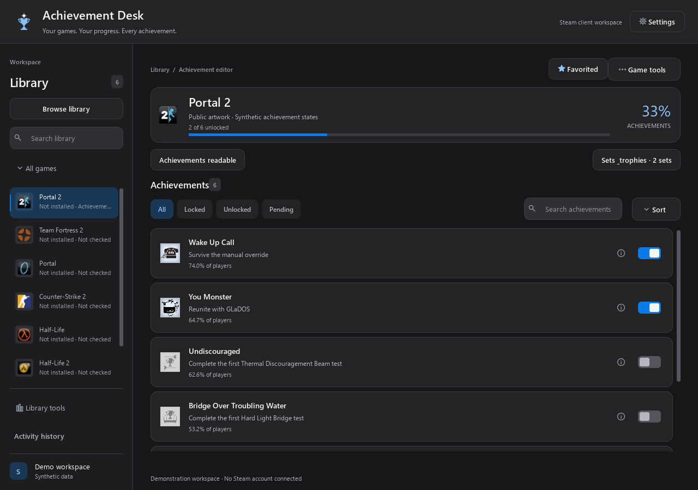
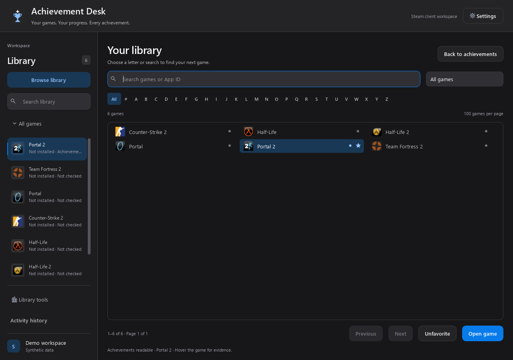
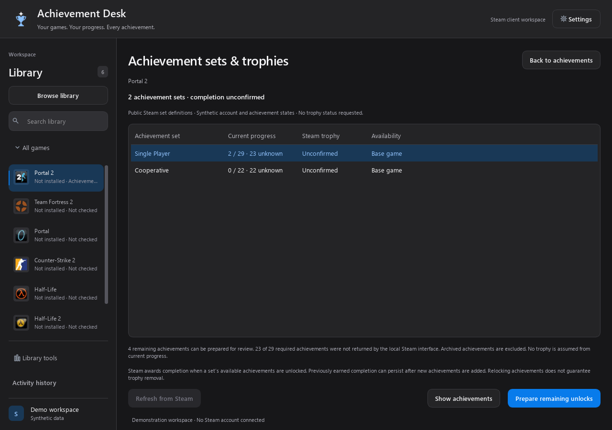

<div align="center">
  
  <h1>Achievement Desk</h1>
  <p>A focused desktop workspace for your Steam achievements.</p>
  <p><strong>Windows x64 · Stable release · English interface</strong></p>
  <p>
    <a href="#features">Features</a> ·
    <a href="#getting-started">Getting started</a> ·
    <a href="docs/FEATURES.md">User guide</a> ·
    <a href="docs/TROUBLESHOOTING.md">Troubleshooting</a>
  </p>
</div>



*Actual application widgets with public Steam artwork and synthetic account and
achievement states. These screenshots do not show a real user's account.*

## Availability

**1.0.0** is the first stable release for Windows x64.

- [Download the installer](https://github.com/DanCarrillo11/AchievementDesk/releases/download/v1.0.0/AchievementDesk-1.0.0-Setup.exe)
- [Download the portable ZIP](https://github.com/DanCarrillo11/AchievementDesk/releases/download/v1.0.0/AchievementDesk-1.0.0-Portable.zip)
- [Release notes and SHA-256 checksums](https://github.com/DanCarrillo11/AchievementDesk/releases/tag/v1.0.0)

The downloads include the runtime; Python is only needed for development.
Live operations require an online, signed-in Steam desktop client. No Steam
password or API key is requested.

## Features

- **Your library, in one window.** Search by title or App ID, browse with A–Z
  filters and 100-game pages, and keep favorites and recent games per account.
  Accessible games can appear even when they are not installed.
- **Fast repeat launches.** After the first complete Steam library discovery, an
  account-specific snapshot loads on later launches once the signed-in Steam
  account is verified. Use **Library tools → Refresh library** or **Ctrl+R** on
  the library page to check for newly added, removed or installed games.
- **Clear achievement switches.** Prepare unlocks or relocks, search and filter
  the full list, and review every change before applying it to Steam.
- **Achievement sets and trophies.** Read Steam's reported set completion, filter
  by set and prepare remaining eligible unlocks. Unavailable data stays unconfirmed.
- **Compatibility evidence.** Distinguish readable games, confirmed changes,
  rejected operations and unconfirmed outcomes using local per-account evidence.
- **A quiet dark workspace.** Small Steam game icons, achievement artwork,
  optional rarity, compact rows, keyboard shortcuts and remembered preferences.
- **Traceable results.** Record activity and save a reference snapshot before
  writes. Confirmed, rejected, partial and unknown outcomes remain separate.

<details>
  <summary>Library and achievement-set views</summary>





</details>

## Getting started

1. Run the setup, or extract the **complete** portable ZIP into a folder.
2. Start Steam, sign in and stay online.
3. Open **AchievementDesk.exe** and let the first library scan complete.
4. Select a game, prepare changes with the achievement switches, then choose
   **Review changes** and **Apply to Steam**.

Searching, filtering and preparing drafts never submit achievement changes.
Keep the portable application's helper and `_internal` folder beside its main
executable. The library is remembered per account; use **Library tools → Refresh
library** after acquiring games or changing installations.

**Upgrading from a preview:** close Achievement Desk and run the new setup over
the existing installation. For the portable version, extract into a new folder.
Preferences, favorites, library snapshots and history stay in the same local data
folder. An empty update channel from older builds automatically uses this repository.

To explore without Steam, start `AchievementDesk.exe --demo`. See the
[user guide](docs/FEATURES.md) for shortcuts, settings and advanced actions.

## Compatibility and completion

Game discovery establishes account access, not guaranteed edit support.
Protected or server-controlled achievements can reject client changes. Steam
client updates can also affect the versioned native interfaces the application uses.

Steam controls completion trophies. Completing a set's available achievements can
earn completion, and previously earned completion can persist after new
achievements are added. Relocking achievements does not guarantee trophy removal.
The app never infers a Steam trophy from a 100% bar or pending changes.

Reference snapshots cannot restore historical unlock dates, trophy history or
game saves. Steam may briefly show a selected game as **Running** while its native
achievement helper is connected; the manager does not launch the game executable.

## Validation

Automated Windows checks cover drafts, reviewed writes, account isolation,
partial/unknown outcomes, library caching, artwork recovery and update selection.
The release workflow also checks the frozen helper and offscreen interface,
clean installation, upgrade from 0.8.2-preview, retained local data and uninstall
before publication. These synthetic checks do not modify a Steam account.

The owner reports successful use with their tested games. One independently
recorded real relock was acknowledged by Steam and confirmed in a fresh process,
with the other achievement states unchanged. See the [verification report](docs/validation/relock-2026-10-30.md)
and [1.0 release scope](docs/validation/stable-1.0.0.md). Compatibility is recorded
per game and account; no universal compatibility or Valve approval is claimed.

## Development

Python 3.11+ x64 is required to run from source:

```powershell
git clone https://github.com/DanCarrillo11/AchievementDesk.git
cd AchievementDesk
python -m venv .venv
.\.venv\Scripts\python.exe -m pip install -r requirements.txt
.\.venv\Scripts\python.exe app.py --demo
```

```powershell
.\.venv\Scripts\python.exe -m unittest discover -s tests -v
```

The automated suite requires no Steam account and performs no live achievement
writes. [Architecture](docs/ARCHITECTURE.md) explains the UI, isolated worker and
Steam adapter. [Contributing](CONTRIBUTING.md) covers changes and validation.

Build locally with `requirements-build.txt` and `AchievementDesk.spec`.
The **Build Windows release** workflow verifies and packages the application.
A version-matched release request on `main` publishes only after its checks pass.
See [release preparation](docs/RELEASES.md).

## Privacy and support

Local data is stored under `%LOCALAPPDATA%\AchievementDesk`. The
`library-cache` folder keeps only per-account game IDs, names, installed flags
and Steam icon hashes. The snapshot is only a display shortcut, not proof of
current ownership or editable achievement support. It does not contain login
credentials or achievements. Corrupt caches are ignored and rebuilt. Optional completion
checks send account/App IDs directly to Steam Community without cookies or
credentials. Artwork and completion requests can be disabled separately.
Read the [privacy guide](docs/PRIVACY.md), [troubleshooting guide](docs/TROUBLESHOOTING.md)
and [security reporting policy](SECURITY.md) before sharing logs or screenshots.

Report reproducible problems through [Issues](https://github.com/DanCarrillo11/AchievementDesk/issues).

## Credits and license

An independent Python implementation with a native adapter adapted from
[Steam Achievement Manager / SAM.API](https://github.com/gibbed/SteamAchievementManager).
Achievement Desk is not affiliated with Valve or the SAM author.

Original project code is [MIT licensed](LICENSE). Adapted SAM.API portions retain
their zlib notice. Qt/PySide6 and artwork credits are documented in
[third-party notices](THIRD_PARTY_NOTICES.txt) and [licenses](licenses/).
