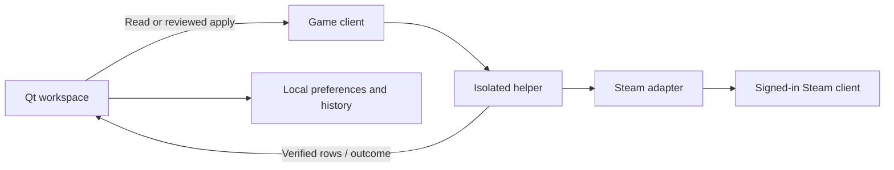

# Architecture

Achievement Desk is a Python/PySide6 Windows desktop application. Runtime
dependencies are pinned in `requirements.txt`; the native adapter uses the
standard library and the user's installed Steam client.

| Component | Responsibility |
| --- | --- |
| `app.py` | Desktop, synthetic-demo and isolated-worker entry points |
| `modern_ui.py`, `design.py` | Qt workspace, presentation, drafts and review |
| `library_view.py`, `completion_view.py` | Embedded library and achievement-set pages |
| `domain.py` | Change planning, stale-state validation, snapshots and verified outcomes |
| `transport.py`, `worker.py` | JSON messages and short-lived helper processes |
| `native.py` | Versioned Steam interfaces, identity checks and native callbacks |
| `library.py`, `catalog.py` | Local manifests, public App IDs and account-access discovery |
| `completion.py`, `media.py` | Optional Steam set/completion data, artwork and rarity |
| `compatibility.py`, `workspace.py` | Account-scoped evidence, preferences and history |
| `updates.py` | Explicit GitHub release lookup without automatic installation |

## Read and write flow

A real game read/apply creates a helper and closes it before displaying the
result. Browsing, filtering and drafting use the loaded snapshot. Library
discovery uses App ID 0 and does not initialize a game's achievement interface.

Before a write, the worker checks the account, refreshes rows, validates the
reviewed states and durably writes a reference snapshot. It submits once,
waits for Steam's save acknowledgement and reads the states again. Rejections,
partial operations and unknown outcomes must not be presented as full success.

The set page prepares ordinary achievement drafts; it does not directly set or
delete trophies. Public schema/account mismatches leave completion unconfirmed.
Compatibility records observed operations instead of probing with writes.

## Tests and packaging

Tests use synthetic workers, temporary data folders, parsed public-data fixtures
and Qt's offscreen platform. Real-account checks are separate, owner-authorized
and documented with redacted evidence. CI never requires Steam credentials.

PyInstaller builds a GUI executable and a helper sharing the packaged runtime.
Both executables and `_internal/` must remain together. The per-user installer
includes the same folder. `tools/package_release.py` copies only approved source
and documentation paths, excluding local account data and research files.

The older Tk prototype (`ui.py`, `widgets.py`) remains as source/regression
coverage. It is not the active frontend and is not bundled in the portable app.
